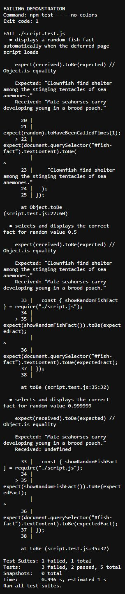
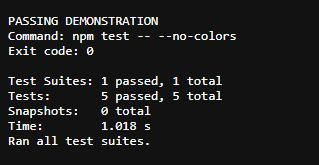

# Jest demonstration: FAILING and PASSING

This activity adds `showRandomFishFact()` to the existing fish appreciation site. The deferred `script.js` calls it automatically after the HTML is parsed. It selects one of three fish facts with `Math.floor(Math.random() * fishFacts.length)` and displays it in `#fish-fact`.

## Run the checks

Use Node.js 22 (the version used in GitHub Actions) or a compatible newer version:

```bash
npm ci
npm run lint
npm test -- --ci
```

Jest uses its jsdom environment to load the actual page markup. Its five tests check automatic display when the deferred script executes, selection at random values 0, 0.5, and 0.999999, and both directions of the existing tide button. Random values are mocked so the tests are repeatable.

## Reproduce both demonstrations

```bash
npm run test:demo
```

Run this locally with no concurrent test or deployment process. The demonstration temporarily changes `Math.floor` to `Math.ceil` in `script.js`, runs the real Jest suite, restores the original source in a `finally` block, and reruns the same suite. It checks that the first run exits with 1 and the second with 0. It never pushes the broken version. If interrupted by a forced process termination, inspect `script.js` and restore `Math.floor` before committing.

### FAILING demonstration

Intentional regression:

```js
const factIndex = Math.ceil(Math.random() * fishFacts.length);
```

Rounding up chooses index 2 instead of index 1 for a random value of 0.5, and index 3 (outside the array) for 0.999999. Jest catches the wrong fact and missing fact:

```text
FAILING DEMONSTRATION
Exit code: 1
Test Suites: 1 failed, 1 total
Tests:       3 failed, 2 passed, 5 total
```

[Complete recorded FAILING output](test-evidence/FAILING.txt)



Screenshot of the unedited recorded local Jest output displayed in the browser, including assertion failures and the final summary.

### PASSING demonstration

Correct implementation restored:

```js
const factIndex = Math.floor(Math.random() * fishFacts.length);
```

The identical tests then pass:

```text
PASSING DEMONSTRATION
Exit code: 0
Test Suites: 1 passed, 1 total
Tests:       5 passed, 5 total
```

[Complete recorded PASSING output](test-evidence/PASSING.txt)



Screenshot of the unedited recorded local Jest output displayed in the browser. The capture is cropped to the output area.

These are local demonstration results recorded on October 29, 2026. The screenshots capture the saved FAILING.txt and PASSING.txt outputs from commit `6e447fb`, displayed in the browser. The underlying output text was not edited. Only the corrected implementation is committed and deployed.

## Deployment gate

The workflow has three separate jobs in this order:

```text
lint -> test -> deploy
```

- `lint` runs `npm ci` and `npm run lint`.
- `test` declares `needs: lint`, installs dependencies, and runs `npm test -- --ci`.
- `deploy` declares `needs: [lint, test]`, so it runs only when both checks succeed.

A failed lint skips testing and deployment. A failed Jest test skips deployment. There is no `continue-on-error` or condition that bypasses a failed check. The intentional failure demonstration is local; it is not a failing GitHub Actions run.

[View GitHub Actions runs](https://github.com/jacob-cob-null/SEN10-Quiz-12/actions)
